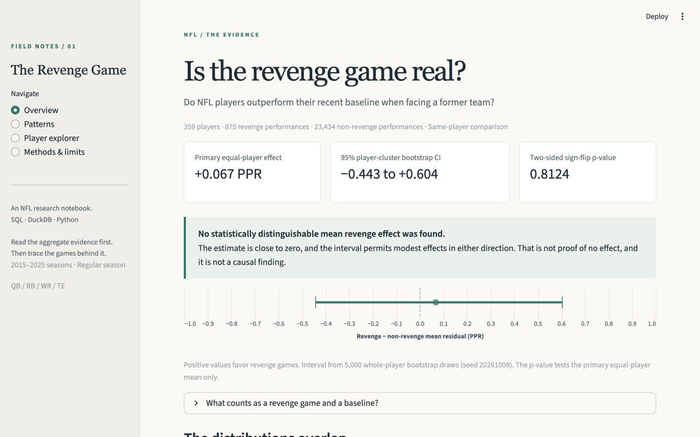
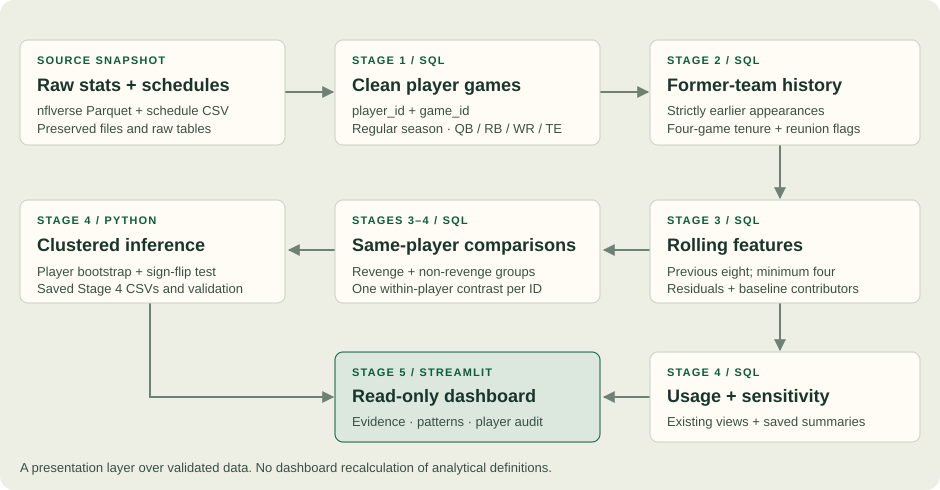

# The Revenge Game

**Do NFL players outperform their own recent baseline when facing a former team?**

The revenge-game story is familiar: a player faces his old team and has something
to prove. Does that show up in the numbers?

This project uses NFL player stats from 2015–2025 to compare how players perform
against former teams with how those same players perform in other games. SQL and
DuckDB handle the game histories, Python handles the statistical tests, and a local
Streamlit dashboard lets you explore the results.

## The finding

Across **359 players, 875 revenge performances, and 23,434 non-revenge performances**,
the average difference was **+0.067 PPR**, after subtracting each game's recent
baseline and giving every player equal weight:

- **95% player-clustered bootstrap CI: −0.443 to +0.604 PPR**
- **Two-sided player sign-flip p-value: 0.8124**
- **No statistically distinguishable mean revenge effect was found.**

That is less than one tenth of a fantasy point. The confidence interval includes
both small negative and positive effects, so these data do not give a clear reason
to expect a mean revenge-game boost. That does not prove the effect is zero. Even a
statistically significant difference would need to be large enough to matter on
the field or in fantasy football. This comparison cannot tell us whether revenge
causes a change in performance.

The pooled, game-weighted mean is −0.021 PPR (95% CI −0.406 to +0.381). Trimming and
winsorization leave mean contrasts near zero. The positive secondary average of
within-player median contrasts is exploratory and does not overturn the primary
mean result. Usage and efficiency patterns vary by position and valid sample size.
[Read the full inference report](docs/stage4_results.md).

## Run the local dashboard



The dashboard shows the overall result, position breakdowns, and individual game
histories. The stadium image is [AI-generated](dashboard/assets/editorial-stadium.md)
and does not depict a real NFL venue.

From this repository, with the validated database and Stage 4 outputs already present:

```bash
source .venv/bin/activate
python -m pip install -r requirements-dashboard.txt
python -m streamlit run dashboard/app.py
```

Open **http://127.0.0.1:8502**. You can browse the results, compare positions, or look
up a player. Tom Brady, Matthew Stafford, Davante Adams, and Jerry Jeudy are included
as starting examples. Select a game to see the earlier appearances used to set its
baseline. The dashboard reads saved results and DuckDB views without changing them.

### Fresh setup

Python **3.9.6** was used for validation. Python 3.9+ is required by the pinned
dashboard stack. Data files are local artifacts and are not tracked in Git.
Initial ingestion requires internet access to download the nflverse snapshot.

```bash
python3 -m venv .venv
source .venv/bin/activate
python -m pip install -r requirements-dashboard.txt
python scripts/load_data.py
python scripts/build_stage2.py
python scripts/build_stage3.py
python scripts/analyze_stage4.py
python scripts/validate_stage5.py --record-baseline
python scripts/validate_stage5.py
python -m unittest discover -s tests -v
python -m streamlit run dashboard/app.py
```

Record the preservation baseline **once**, after a successful Stage 4 build; the
command refuses to overwrite it. It proves later presentation work leaves that
snapshot unchanged. On a fresh machine, downloaded source revisions may produce
different results; the dashboard displays that machine's saved outputs.

For a cached-data rebuild, replace ingestion with
`python scripts/load_data.py --offline --verify-rerun`, then run Stages 2–4 in order.
Stop the dashboard with **Ctrl+C** before rebuilding. A deliberate upstream rebuild
may invalidate the Stage 5 byte-level preservation baseline; do not overwrite it
just to conceal a mismatch. Review the changed snapshot first. Missing or inconsistent
Stage 4 outputs produce an actionable dashboard message instead of invented values.

## Method and technology

**DuckDB 1.4.4 · SQL · Python · Streamlit 1.50.0 · Altair 5.5.0 · pandas 2.3.3**

1. Clean source statistics and schedules; retain stable player and game IDs.
2. Label a former opponent only after **four strictly earlier recorded appearances**
   for that franchise. First meeting means first observed qualifying meeting.
3. Compute expected PPR from the **previous eight appearances**, requiring at least
   four. Windows span seasons and transfers; current/future games never contribute.
4. Compare actual-minus-expected PPR in revenge and non-revenge games from the
   **same players**. The primary estimate gives each player's mean contrast equal weight.
5. Use **5,000 whole-player bootstrap draws** (seed `20261008`) and a two-sided
   player sign-flip test (seed `20261009`). Usage, valid-denominator efficiency,
   subgroup summaries, and outlier checks support interpretation.

The calculations are defined in SQL. Python runs the resampling tests and dashboard.
Receptions remain separate from opportunities; undefined efficiency ratios and
standardized scores remain missing, not zero. [Data dictionary](docs/data_dictionary.md).



## Repository guide

| Location | What to review |
| --- | --- |
| `project.md` | Original research scope and five-stage plan |
| `sql/01_…` through `sql/14_…` | Validated ingestion, history, features, inference datasets, and checks |
| `sql/15_dashboard_queries.sql` | Read-only presentation queries and parameterized player drill-downs |
| `scripts/` | Ordered pipeline builders, query helper, inference, Stage 5 validator |
| `dashboard/` | Streamlit pages, data access, chart encodings, and styling |
| `reports/tables/stage4_*.csv` | Twelve saved analytical tables, including inference and bootstrap draws |
| `reports/stage5_validation.json` | Latest live SQL/dashboard checks and preservation hashes |
| `tests/` | Synthetic, regression, reproducibility, and dashboard interaction tests |
| `data/raw/`, `data/processed/` | Local source snapshot, DuckDB database, and checkpoint reports (Git-ignored) |

## Validation and limitations

```bash
python scripts/validate_stage5.py
python -m unittest discover -s tests -v
python -m pip check
```

The validator reruns Stages 1–4 SQL checks read-only and checks dashboard inputs,
saved headline agreement, stable IDs, finite plot metrics, examples, and preservation.
Stage 5 adds interaction tests without changing the earlier pipelines or tests.
[Stage 5 verification and file guide](docs/stage5_results.md).

History starts in 2015; roster-only stints, earlier service, postseason, and other
positions are outside scope. Player clustering handles repeated games, but shared
teams/opponents/games can leave cross-player dependence. Role, injury, opponent
strength, age, and selection are not causally controlled. Sparse revenge histories
and multiple exploratory comparisons limit subgroup and median interpretations.

Detailed checkpoints remain available: [Stage 1](docs/stage1_results.md) ·
[Stage 2](docs/stage2_results.md) · [Stage 3](docs/stage3_results.md) ·
[Stage 4](docs/stage4_results.md) · [Stage 5](docs/stage5_results.md).
Source: [nflverse statistics](https://nflreadr.nflverse.com/reference/load_player_stats.html)
and [schedules](https://nflreadr.nflverse.com/reference/load_schedules.html).

The dashboard runs locally; there is no hosted version.
